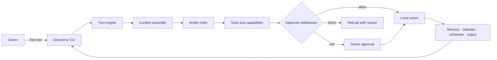

# Daedalus

> A single-user, local-first chief-of-staff agent for your laptop.

Daedalus turns free-text requests into useful, inspectable work. It runs on the owner's laptop, is reached primarily through Discord, and composes behavior at runtime from memory, tools, schedules, and authored capabilities. The laptop remains the trust boundary: sensitive values stay local, while external actions are explicit and approval-gated.

- **Say what you want.** No slash-command vocabulary or hardcoded workflow is required.
- **Keep the hard boundaries deterministic.** The model proposes; the engine decides what is allowed.
- **Grow by capability.** Recurring work becomes a local, versionable capability with a manifest, checks, and its own state.
- **Stay personal.** One owner, one trust root, durable memory, and optional specialist identities.

[Quickstart](#quickstart) · [How it works](#how-it-works) · [CLI](#cli) · [Development](#development) · [Status and limits](#status-and-limits) · [Documentation](#documentation)

## What Daedalus is — and is not

| Daedalus is | Daedalus is not |
|---|---|
| A self-hosted chief-of-staff agent for one person | A multi-tenant assistant or hosted SaaS |
| A free-text loop that composes behavior from capabilities | A collection of fixed, hardcoded user flows |
| A local-first runtime with approval middleware | A system that silently sends private data to remote models |
| A file-first, inspectable workspace | An opaque hosted memory store |
| A Discord surface backed by a laptop daemon | A Discord bot that is safe to expose publicly |

The design source of truth is [`SPEC.md`](SPEC.md). If this README and the spec disagree, the spec wins.

## How it works



The runtime is one loop:

1. Receive an owner message or a scheduled wake.
2. Resolve the active cabinet seat and assemble its charter, memory namespace, capability inventory, resource inventory, and conversation context.
3. Ask the configured model chain to reason and propose tool calls.
4. Run each proposal through deterministic risk, provenance, scope, secret, and egress checks.
5. Execute allowed work, ask the owner for approval when required, and refuse blocked work clearly.
6. Return the result through Discord, the CLI, a file, a loopback dashboard, or a configured device output.

### Capability substrate

Daedalus is extended through authored capabilities rather than feature-specific scripts:

```text
$DAEDALUS_HOME/capabilities/<name>/
  run.py             # deterministic artifact
  manifest.toml      # input/output, scopes, limits, and schedule
  README.md          # why the capability exists
  state/             # checkpoints and outputs
  .venv/             # isolated dependencies
```

A newly authored capability runs once through the Melinoë verification gate before it can be scheduled. Scheduled runs execute the artifact directly, without putting a model in the execution loop. Network access, filesystem roots, secrets, and resource limits remain declared and enforced.

### Memory, calendar, and proactive work

- Memory is file-first, indexed by SQLite, and supports supersession, bitemporal facts, namespaces, and a `local_only` boundary.
- The internal Daedalus calendar is file-first (`.ics`) with recurrence, exceptions, time zones, reminders, search, conflict detection, bulk edits, and import.
- The scheduler runs cron-like jobs and one-shot reminders, catches up missed work, and avoids duplicate external side effects.
- Proactive wakes are gated by quiet hours and a daily speaking cap before the model is reached. The model may still choose silence.
- Notifications produced by an owner-requested capability are distinct from a proactive wake and are delivered when that capability says they should be.

### Cabinet seats

The cabinet is a set of durable identities, not a set of processes. Each seat has a charter and a memory namespace over the same loop. One seat is active at a time; messages can be routed to another seat by explicit address or by a bounded routing question. Seat-to-seat work uses a durable typed queue with correlation and causation identifiers.

The cabinet substrate is implemented, but seats are being wired one at a time. No additional cabinet identity is part of the delivered default until its proof-of-life is earned.

## Quickstart

Daedalus targets Python 3.14 and uses `uv`.

### 1. Install dependencies

```bash
uv sync
```

### 2. Run first-time setup

The setup wizard is interactive and re-runnable. It provisions the state directory, encrypted secret store, model providers, optional resources, Discord, trust posture, user services, and the mandatory self-test.

```bash
./scripts/setup.sh
```

For a scripted run using existing configuration and environment values:

```bash
./scripts/setup.sh --yes
```

The wizard writes runtime state under `$DAEDALUS_HOME` (default: `~/.daedalus`). It does not print secret values. See the wizard help for supported environment variables:

```bash
./scripts/setup.sh --help
```

### 3. Verify the install

```bash
uv run daedalus selftest
```

The self-test covers the runtime, memory, calendar, capabilities, approvals, scheduler, dashboard serving, and the Discord surface where configured. Add `--live` to probe configured model providers and live integrations.

### 4. Start Daedalus

```bash
uv run daedalus run
```

The normal surface is Discord DM. The bot is DM-first and should be restricted to the configured owner allowlist. For a local terminal session instead:

```bash
uv run daedalus run --cli
```

Then try a request such as:

```text
Remember that the P0 loop is verified.
```

## CLI

```text
daedalus version
daedalus selftest [--live] [--json]
daedalus ask [--yes] <free-text>
daedalus calendar import <file.ics> [--replace] [--local-only]
daedalus seats
daedalus activate <seat>
daedalus serve [--port 8787] [--publish]
daedalus run [--cli] [--tick-seconds 60]
daedalus wake [--force]
```

Useful examples:

```bash
# Send one request without starting the Discord daemon.
uv run daedalus ask "What is on my calendar tomorrow?"

# Inspect and change the active cabinet identity.
uv run daedalus seats
uv run daedalus activate daedalus

# Import an existing calendar file into the local calendar.
uv run daedalus calendar import ~/Downloads/calendar.ics

# Serve the generated dashboard on the laptop only.
uv run daedalus serve
```

`daedalus serve` is loopback-only by default and the viewer is read-only. The daemon owns dashboard controls. Publishing through Tailscale is a separate, guarded action; public Funnel exposure is not part of the trust model.

## Runtime state

Code belongs in this repository. Owner-owned state belongs under `$DAEDALUS_HOME`:

```text
$DAEDALUS_HOME/
  config.toml                 # runtime and trust settings
  .env                        # local configuration; owner-only
  resources/                  # registry, encrypted credentials, master key
  memory/                     # facets, namespaces, and SQLite index
  calendar/                   # events.ics, index, and sync state
  capabilities/               # authored capabilities and isolated venvs
  cabinet/                    # seat charters and durable messages
  approvals/                  # grants and audit log
  state/                      # wakes, rate limits, reminders, processes
  ui/                         # generated dashboard artifacts
  logs/                       # local logs
```

Private data is intentionally out of bounds for the coding agent and for Daedalus at runtime: passwords, `.env` contents, private documents, vault data, and health, financial, relationship, or location data must not be opened, logged, summarized, or transmitted.

## Development

Run the focused checks first, then the full suite when changing behavior:

```bash
uv run pytest
```

The project uses `pytest` and `pytest-asyncio`; tests live in `tests/`. Keep changes aligned with the relevant section of [`SPEC.md`](SPEC.md), and add a verbose entry to [`CHANGELOG.md`](CHANGELOG.md) for every user-visible change.

The repository uses a `src/` layout and exposes the `daedalus` console script through `pyproject.toml`:

```text
src/daedalus/
  loop/          # turn engine and context assembly
  model/         # provider chain, routing, and rate limits
  tools/         # Layer-1 primitives
  approvals/     # risk, grants, and middleware
  capabilities/ # authoring, verification, registry, runner
  memory/        # file-first facts and recall index
  calendar/      # local calendar and recurrence
  scheduler/     # jobs, wakes, reminders, and catch-up
  surface/       # Discord and CLI surfaces
  cabinet/       # seats, namespaces, and durable protocol
  genui/         # generated dashboards and controls
  security/      # provenance, sink policy, quarantine, env
```

## Status and limits

P0, P1, and P2 are delivered as code, along with the internal calendar and the P3 cabinet substrate:

- loop, primitives, capability authoring, Melinoë verification, and scheduled execution;
- file-first memory with local-only protection;
- calendar, reminders, recurrence, import, and derived indexing;
- proactive scheduling with quiet hours, a daily cap, and fresh wake composition;
- Discord and CLI surfaces, approvals, encrypted secrets, and the setup wizard;
- cabinet charters, namespaces, activation, routing, and the durable seat-to-seat queue.

Still deliberately staged or incomplete:

- cabinet seats are activated one at a time rather than all being part of the default;
- Google Calendar (`gcal`) provisioning exists, but the integration is not built;
- remote/Tailscale publication, OpenCode delegation, and group chat remain later phases;
- read-only mail is intentionally last;
- voice/audio and non-Discord notification transports are not built.

This is a single-user local system, not a hardened multi-user service. Do not expose the Discord bot, dashboard, state directory, or credential store to untrusted users.

## Documentation

| Document | Purpose |
|---|---|
| [`SPEC.md`](SPEC.md) | Normative design and build order |
| [`ARCHITECTURE.md`](ARCHITECTURE.md) | Component boundaries, runtime model, and repository layout |
| [`AGENTS.md`](AGENTS.md) | Working rules for contributors and coding agents |
| [`CHANGELOG.md`](CHANGELOG.md) | User-visible decisions and changes |
| [`TICKETS.md`](TICKETS.md) | Tracked implementation work |

## License

No license has been declared yet.
